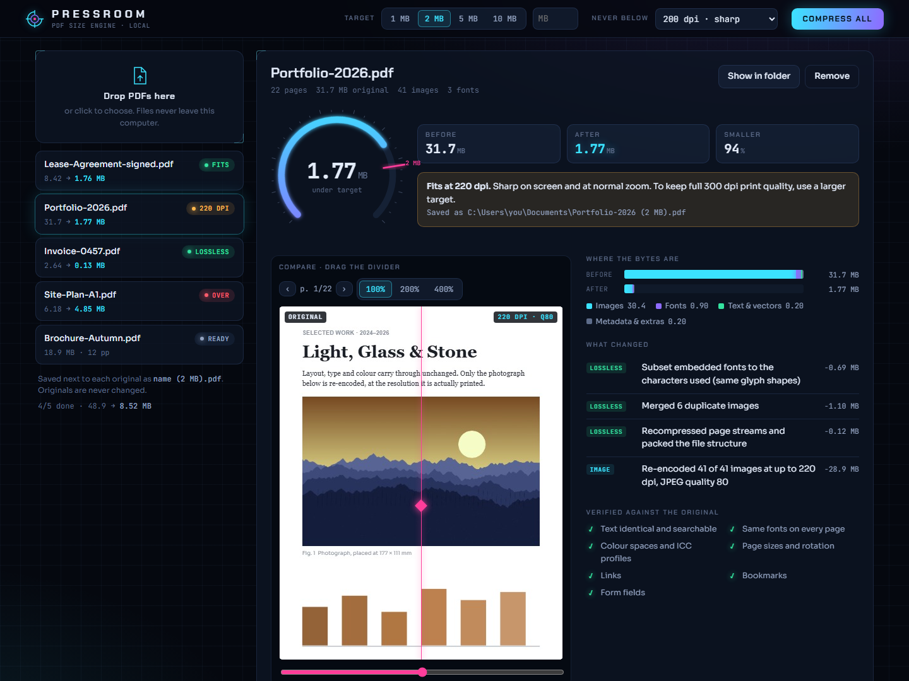
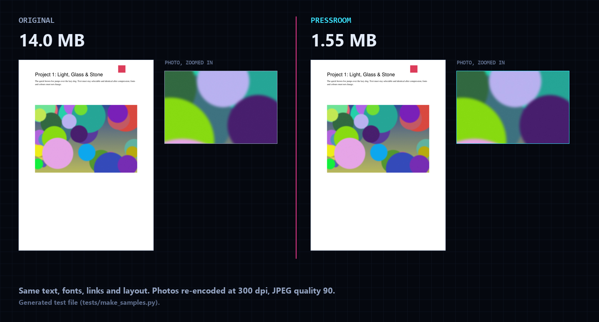
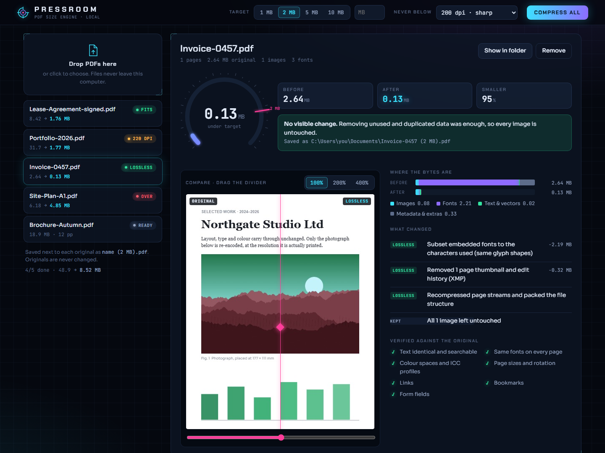
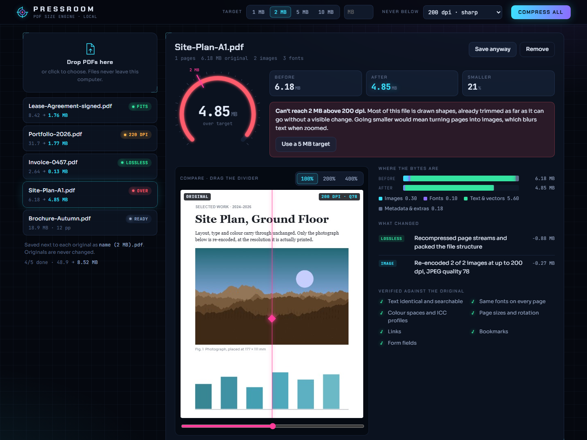

# Pressroom

**Shrink PDFs to a size limit (say, 2 MB for an upload form) without them looking any different.**

Pressroom is a local Windows app. It keeps text, fonts, vector graphics and colours exactly as they
are, and changes only what it has to, in this order:

1. Lossless clean-up first
2. Invisible precision trims next
3. Photos last, at the highest quality that still fits

Your files never leave your computer.

> Built with [Claude Code](https://claude.com/claude-code). The code is AI-generated; I directed it,
> tested it on real documents and steered the fixes.



## Why another PDF compressor?

Most compressors (online tools, Ghostscript's `/ebook` preset) re-render the whole document. That's
how fonts get swapped, CMYK turns into RGB, colour profiles disappear and crisp text in images turns
blurry. Pressroom works on the existing file instead:

| Where the size usually is | What Pressroom does | Visible change |
|---|---|---|
| Fonts embedded in full | Keeps only the characters actually used, with the same glyph shapes | None |
| Duplicates, thumbnails, edit history | Merges and removes them | None |
| Figma, Sketch and other design-tool exports | Rounds drawing coordinates from 6 decimals to 0.01 pt (finer than any printer dot), then checks that every page renders the same | None |
| Soft fades and transparency masks | Stores them as high-quality JPEG | None at normal zoom |
| Photos and scans | Downsamples only images that are sharper than their printed size needs, using the best quality that fits the target | Depends on the target, and the app tells you |



### What it won't do

- **Touch small images.** Logos and icons under 32 KB are left exactly as they are.
- **Change colour spaces.** CMYK stays CMYK, and spot and indexed colours are never re-encoded.
- **Go below your quality floor.** You choose the minimum dpi (default 200). If a file can't reach the
  target above that floor, Pressroom says so and suggests options. It never quietly makes the file worse.
- **Turn text or drawings into images.**
- **Overwrite your file.** Output is saved next to the original as `name (2 MB).pdf`.

<p>
  
  
</p>

### Every result is checked

After compressing, Pressroom reopens the output and compares it with the original:

- page count, sizes and rotation
- the extracted text of every page
- the fonts used on every page
- links, bookmarks and form fields

Each re-encoded image is decoded again and compared with the source, and is put back as it was if the
colours don't match.

## How the quality search works

Pressroom tries a ladder of quality levels from best (300 dpi, JPEG quality 94, full colour detail)
down to your floor. It uses a binary search, so it usually needs 4–6 trial encodes. It aims 2.5% under
the target, using decimal MB (2 MB = 2,000,000 bytes), so upload forms accept the file whichever way
they count. The full reasoning is in [DESIGN.md](DESIGN.md).

## Set up (Windows)

Needs Python 3.12 (`winget install Python.Python.3.12`).

```powershell
py -3.12 -m venv .venv
.\.venv\Scripts\python.exe -m pip install -r requirements.txt
.\build.ps1        # produces dist\Pressroom\Pressroom.exe
```

Run `dist\Pressroom\Pressroom.exe`. Drop PDFs in, pick a target and click **Compress all**.

Opening `ui/index.html` in a browser shows the interface in demo mode, with example files and
simulated results.

## Develop

```powershell
.\.venv\Scripts\python.exe -m pressroom.app                       # run from source
.\.venv\Scripts\python.exe tests\make_samples.py                  # generate test PDFs
.\.venv\Scripts\python.exe tests\run_engine.py tests\samples 2    # compress them, print a report
```

| Path | What it is |
|---|---|
| `pressroom/engine.py` | Analysis, lossless pass, image pass, quality search, verification |
| `pressroom/precision.py` | Content-stream tokenizer that trims excess decimal places from paths and colours |
| `pressroom/app.py` | Desktop window (pywebview) and the API the UI calls |
| `ui/index.html` | The whole interface: real mode in the app, demo mode in a browser |
| `tests/` | Sample PDF generator and engine runner |

Built with [PyMuPDF](https://pymupdf.readthedocs.io/), [Pillow](https://python-pillow.org/),
[fontTools](https://github.com/fonttools/fonttools) and [pywebview](https://pywebview.flowrl.com/).

## Licence

[GNU AGPL-3.0](LICENSE). You're free to use, change and share Pressroom, as long as anything you
distribute that's based on it is also open source under the same licence. Pressroom is AGPL because
it builds on PyMuPDF, which is AGPL-licensed.

The bundled UI fonts (Chakra Petch, Sora, JetBrains Mono) are under the SIL Open Font License. See
`ui/fonts/OFL-*.txt`.
